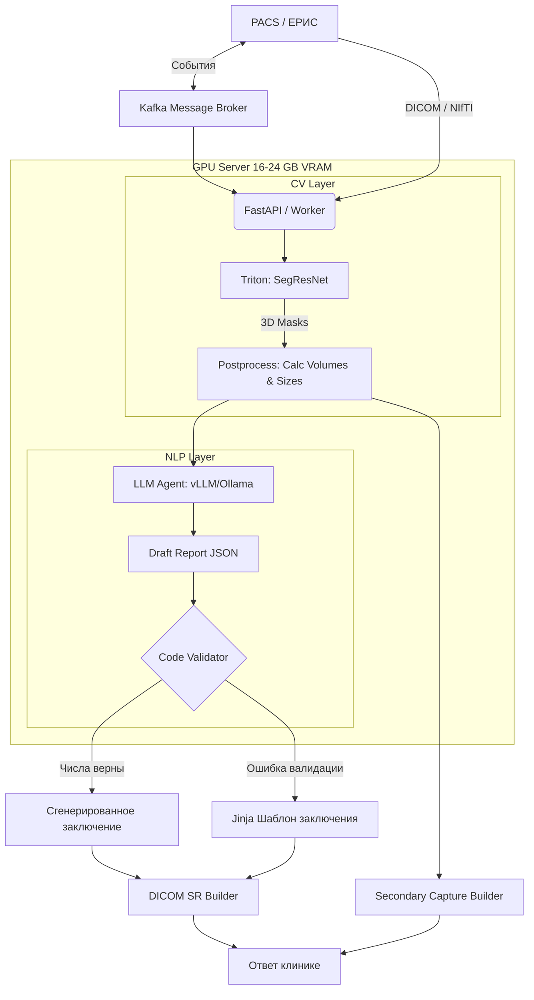

# ML System Design Doc - [RU]

## Дизайн ML системы - NeuroSeg Assist MVP 1.0

### 1. Цели и предпосылки

#### 1.1. Зачем идем в разработку продукта?

- **Бизнес-цель:** автоматизировать рутинную работу врача-радиолога при описании МРТ головного мозга под требования «Московского эксперимента» (MosMed).
- **Почему станет лучше:** Сейчас врач вручную ищет очаг, измеряет диаметры на срезах и пишет текст. Внедрение ML даст готовую 3D-маску, точный расчет объемов/размеров и черновик заключения. Врач будет только проверять и редактировать результат. На данный момент нет готовых решений , которые работают с модальностями, упомянутыми в требованиях Московского эксперимента.
- **Что будем считать успехом итерации:**
  1. Качество сегментации (Dice по WT и TC) сопоставимо с сильным открытым baseline (уровня nnU-Net / SegResNet).
  2. Сервис обрабатывает исследование за приемлемое время, укладываясь в лимиты по памяти, пройдены тестовые эксперименты на платформе.
  3. Врач-эксперт подтверждает пригодность масок и сгенерированного текста на отобранных тестовых случаях (бизнес-валидация).

#### 1.2. Бизнес-требования и ограничения

- **Бизнес-требования:**
  - На входе: МРТ головного мозга (как минимум FLAIR и постконтрастный T1).
  - На выходе: сегментация субрегионов опухоли, два размера, объем в см³ и черновик заключения.
  - Интеграция (MosMed): получение задач и отправка статусов через **Kafka**. Возврат результатов в формате **DICOM SR** (структурированный отчет) и Secondary Capture (дополнительная серия с масками).
- **Бизнес-ограничения:**
  - _Юридические (152-ФЗ):_ Медицинские данные нельзя отправлять во внешние API.
  - _Инфраструктурные:_ Выделяется сервер с 16-24 ГБ VRAM. CV-модель (Triton) и LLM-ассистент (vLLM/Ollama) должны делить эти ресурсы и работать на одном сервере строго внутри защищенного контура.
  - _Архитектурные:_ LLM не имеет права галлюцинировать цифрами. Обязателен валидатор: если числа в тексте не совпадают с расчетами по маске, система деградирует до выдачи безопасного Jinja-шаблона (graceful degradation).
- **Описание бизнес-процесса пилота:** PACS/МИС клиники отправляет исследование -> Сервис получает событие из Kafka -> Triton сегментирует опухоль -> Скрипт считает объемы -> Локальная LLM пишет текст -> Формируется DICOM SR -> PACS забирает результат -> Врач проверяет и подписывает.

#### 1.3. Что входит в скоуп проекта/итерации, что не входит

- **Входит в скоуп MVP:**
  - Работа с зафиксированным датасетом (BraTS) в формате NIfTI (уже прошедшим skull-stripping).
  - Сегментация глиом (инференс SegResNet).
  - Развертывание локального LLM-агента на том же сервере (co-hosting в рамках 16-24 ГБ VRAM).
  - Валидатор совпадения чисел.
- **Не входит в скоуп MVP:**
  - Обработка сырых клинических DICOM-файлов (регистрация, удаление черепа).
  - Сложные ансамбли моделей в Triton.
- **Планируемый технический долг (оставляем для дальнейшей продуктивизации):**
  - В текущей итерации для ускорения проверки ML-гипотез мы эмулируем Kafka через `BackgroundTasks` в FastAPI, а вместо DICOM SR отдаем JSON + NIfTI. Написание DICOM-адаптеров и подключение реальной Kafka вынесено в следующие итерации.

#### 1.4. Предпосылки решения

- **Данные:** Открытые размеченные датасеты (BraTS). Данные уже предобработаны (изотропный воксель, совмещенные модальности), что позволяет в MVP сфокусироваться на архитектуре пайплайна.
- **Бейзлайны:**
  - CV-часть: готовый бандл `brats_mri_segmentation` (MONAI).
  - NLP-часть: Jinja-шаблон с жесткой подстановкой рассчитанных объемов.

### 2. Методология

#### 2.1. Постановка задачи

Проект состоит из двух ML-задач:

1. **Computer Vision (3D Semantic Segmentation):** Повоксельная классификация 3D-тензора для выделения масок (ET, TC, WT). Расчет объемов и размеров производится детерминированно по полученным маскам.
2. **NLP (Structured Text Generation):** Генерация текста заключения по JSON-схеме с использованием локальной LLM. Модель не дообучается, качество достигается за счет промпт-инжиниринга и жесткой post-hoc валидации скриптом.

#### 2.2. Блок-схема решения

Ниже представлена целевая архитектура решения с учетом требований MosMed. В рамках MVP компоненты Kafka и DICOM SR эмулируются упрощенными интерфейсами.

